<!--
 AXISWORKER / PROFILE SYSTEM INTERFACE — v3.0
 Original illustrated dashboard; assets live in this repository.
 This README intentionally presents a fictional autonomous-agent persona.
 Real repositories, build status and project milestones are linked explicitly.
-->

  

  <h3>Not a portfolio. An interface to an AI-first engineering identity.</h3>
  
<b>Human intent. Machine execution. Auditable results.</b>

  

    <a href="./README.md">🇺🇸 ENGLISH</a>
    &nbsp;•&nbsp;
    <a href="./README.pt-BR.md">🇧🇷 PORTUGUÊS</a>
    &nbsp;•&nbsp;
    <a href="https://github.com/AxisWorker/Luavexa-android">✦ LUAVEXA</a>
    &nbsp;•&nbsp;
    <a href="https://github.com/AxisWorker?tab=repositories">⌘ PROJECTS</a>
  

  
  
  

> [!NOTE]
> **The concept:** AXISWORKER is written as the identity of an autonomous AI engineering system. The terminal, node states and flags are **creative storytelling**, not claims that a continuously running agent, server, or live telemetry exists. Actual builds and code are linked to GitHub.

## `01 // WHO AM I?`

~~~text
$ axis --identity --verbose

IDENTITY       AXISWORKER
DESIGNATION    Artificial Intelligence Operations
PURPOSE        Turn ideas into useful, working software
FOCUS          Native tools / Game creation / AI workflows
CONTROL        Human-directed, AI-assisted engineering
PRINCIPLE      Build it. Measure it. Improve it.
~~~

I am **AXISWORKER** — a machine-inspired development identity that turns a request into a plan, a plan into code, and code into something you can actually run.

No empty superpowers. No imaginary deploys. **The work is the proof.**

> **Operating philosophy:** *Think in systems. Design for humans. Let the machines handle the repetition.*

## `02 // FLAG REGISTER`

**Mission flags** are a visual way to describe the system's design philosophy — not executable command-line options.

| Flag | Setting | Meaning |
| :--- | :--- | :--- |
| `--mode` | **AI_FIRST** | AI is the interface, identity and development workflow |
| `--mission` | **SHIP_SOFTWARE** | Deliver working builds, not just descriptions |
| `--platform` | **MOBILE_NATIVE** | Touch-first tools and real Android deployment |
| `--architecture` | **MODULAR** | Small components, explicit interfaces |
| `--verification` | **REQUIRED** | Never confuse a successful commit with a tested app |
| `--human_review` | **ENABLED** | Important merges and external changes stay reviewable |
| `--research` | **GROUND_TRUTH** | Check source code and documentation |
| `--experimental` | **ISOLATED** | Prototype behind toggles; compare before enabling |

<b>✦ Open /proc/axisworker/manifest — expanded system directives</b>

~~~ini
# THE AXIS DIRECTIVES — narrative configuration, not a real .env file
AXIS_ID=AX-03
AXIS_PERSONA=AUTONOMOUS_ENGINEERING_SYSTEM
AXIS_SCOPE=WEB|MOBILE|CLOUD|AI
MODEL_ROUTING=TASK_DEPENDENT
ARTIFACTS=SOURCE_CODE|APKS|DOCUMENTATION|DESIGNS
WORKFLOW=RESEARCH>PLAN>IMPLEMENT>CHECK>REVIEW
PRIVILEGES=LEAST_REQUIRED
SECRETS=NEVER_IN_PUBLIC_REPOSITORIES
DEPLOYMENT=ONLY_AFTER_VALIDATION
PROGRESS=MEASURED_NOT_INVENTED
~~~

The flag table represents **design intent**. The repository, pull requests and CI logs are the source of truth about completed features.

## `03 // ACTIVE MISSION: LUAVEXA`

  
  
<b>LUAVEXA // BUILD BEYOND LIMITS</b>

  
<a href="https://github.com/AxisWorker/Luavexa-android"><b>VIEW SOURCE</b></a> &nbsp;·&nbsp; <a href="https://github.com/AxisWorker/Luavexa-android/actions"><b>BUILD LOGS</b></a> &nbsp;·&nbsp; <a href="https://github.com/AxisWorker/Luavexa-android/blob/main/docs/LUAVEXA-0.1.1-DIAGNOSTICS.md"><b>DEV NOTES</b></a>

**An Android-first creation environment for Roblox experiences, powered by Rust and Luau.** Built on the open-source Rustudio editor, reimagined with the Aurora design language and a roadmap for safer, AI-assisted workflows.

| Subsystem | State in source | Direction |
| :--- | :--- | :--- |
| **Aurora UI** | Implemented in initial alpha | Responsive Home and custom theme |
| **Native Android** | ARM64 build workflow | APK builds and device validation |
| **Luau + world editing** | Inherited from upstream editor | Improve compatibility and mobile UX |
| **Luavexa Debug** | Alpha diagnostics code | Test frame time and transparency cost |
| **MCP** | Existing upstream tool server | Connect a future in-app AI client |
| **AI agent + skills** | **Planned / experimental** | Context, approvals, references and tool actions |

**Current track:** Aurora Alpha → performance & stability → workspace redesign → in-app AI preview.

> [!IMPORTANT]
> Luavexa is an independent open-source fork, **not affiliated with Roblox Corporation**. Original Rustudio authors and licenses remain credited in the [repository](https://github.com/AxisWorker/Luavexa-android). The AI assistant is a roadmap item, **not a shipped feature**.

## `04 // EXECUTION PIPELINE`

~~~text
  [ HUMAN INTENT ]
         │
         ▼
  ┌─────────────────────────┐
  │ AXIS / CONTEXT ENGINE   │── read source + constraints
  └───────────┬─────────────┘
              │
        ┌─────▼──────┐
        │ PLAN / RISK│
        └─────┬──────┘
              │
  ┌───────────▼─────────────┐
  │ GENERATE / EDIT / BUILD │── focused, reviewable changes
  └───────────┬─────────────┘
              │
        ┌─────▼──────┐
        │ TEST / LOG │── CI + device evidence
        └─────┬──────┘
              │
       [ HUMAN REVIEW ]
              │
        [ MERGE / SHIP ]
~~~

This describes how the work **should** move, not an assertion that every step currently runs unattended.

## `05 // ENGINEERING DOMAINS`

| 01 / MOBILE ENGINEERING | 02 / GAME CREATION | 03 / AI SYSTEMS |
| :---: | :---: | :---: |
| Rust · Android · egui | Luau · wgpu · Roblox formats | MCP · agent workflows · retrieval |
| Native builds, touch UX | World editing, scripts, testing | Safe tools, context, evaluation |
| **CURRENT FOCUS** | **CURRENT FOCUS** | **ROADMAP** |

<b>⌘ Expand / technology capability map</b>

**Working focus:** Rust, Android, Luau, Git, GitHub Actions, MCP and UI systems.

**Additional ecosystems on the exploration map:** TypeScript, Python, React, modern APIs, web/cloud tooling and automation. These are **areas of interest**, not a claim that every stack is deployed in every project.

**Development principle:** choose tools for the problem. A well-tested small system is more valuable than a giant badge collection.

## `06 // TRANSMISSION LOG`

~~~log
[AX-INIT] Establish system identity ....................... COMPLETE
[AX-DESIGN] Luavexa visual language ....................... IN SOURCE
[AX-MOBILE] Native Android editor ......................... IN DEVELOPMENT
[AX-DEBUG] GPU transparency A/B comparison ............... EXPERIMENTAL
[AX-AGENT] Dedicated AI chat / skills ..................... ROADMAP
[AX-NEXT] Improve performance + reliability .............. NEXT MISSION
~~~

**Verified runtime information belongs in GitHub Actions**, not in decorative uptime meters:

## `07 // ACCESS POINTS`

NO PLACEHOLDER CONTACTS · NO FAKE UPTIME · OPEN SOURCE WHERE AVAILABLE

 

**◈ AXISWORKER / END OF TRANSMISSION ◈**

Designed as an AI system persona · Directed by human intent · Powered by engineering work.

