<!--
 AXISWORKER / INTERFACE DE PERFIL — v3.0
 Este perfil apresenta uma persona fictícia de um sistema autônomo de IA.
 Projetos, builds e recursos reais são apresentados com seus estados verificáveis.
-->

  

  <h3>Não é um portfólio. É a interface de uma identidade de engenharia baseada em IA.</h3>
  
<b>Intenção humana. Execução por máquinas. Resultados verificáveis.</b>

  

    <a href="./README.md">🇺🇸 ENGLISH</a>
    &nbsp;•&nbsp;
    <a href="./README.pt-BR.md">🇧🇷 PORTUGUÊS</a>
    &nbsp;•&nbsp;
    <a href="https://github.com/AxisWorker/Luavexa-android">✦ LUAVEXA</a>
    &nbsp;•&nbsp;
    <a href="https://github.com/AxisWorker?tab=repositories">⌘ PROJETOS</a>
  

  
  
  

> [!NOTE]
> **O conceito:** AXISWORKER é uma persona criada para parecer um sistema de engenharia de software operado por inteligência artificial. Terminal, módulos e flags fazem parte da **narrativa visual**, não representam um servidor, agente ou telemetria ativa 24 horas. Builds e funcionalidades reais são indicados pelos respectivos links do GitHub.

## `01 // QUEM SOU?`

~~~text
$ axis --identity --verbose

IDENTIDADE     AXISWORKER
DESIGNAÇÃO     Artificial Intelligence Operations
MISSÃO         Transformar ideias em programas funcionais
FOCO           Ferramentas nativas / Games / Fluxos com IA
CONTROLE       Engenharia assistida por IA e dirigida por humanos
PRINCÍPIO      Construir. Medir. Melhorar.
~~~

Eu sou **AXISWORKER** — uma identidade de desenvolvimento inspirada em máquinas. Recebo uma ideia, transformo em plano, implemento o código e busco entregar algo que você possa executar de verdade.

**Não são superpoderes inventados. O código é a evidência.**

> *Pense em sistemas. Projete para pessoas. Deixe as máquinas lidarem com a repetição.*

## `02 // REGISTRO DE FLAGS`

Estas flags representam a **filosofia visual e de engenharia** da AxisWorker; não são opções reais de um programa de terminal.

| Flag | Valor | Significado |
| :--- | :--- | :--- |
| `--mode` | **AI_FIRST** | IA como interface, identidade e fluxo de trabalho |
| `--mission` | **SHIP_SOFTWARE** | Entregar builds reais, não só promessas |
| `--platform` | **MOBILE_NATIVE** | Aplicativos nativos e foco em Android |
| `--architecture` | **MODULAR** | Componentes organizados e testáveis |
| `--verification` | **REQUIRED** | Um commit não é um aplicativo testado |
| `--human_review` | **ENABLED** | Mudanças importantes passam por revisão |
| `--research` | **GROUND_TRUTH** | Conferir código e documentação original |
| `--experimental` | **ISOLATED** | Funcionalidades experimentais podem ser comparadas e desligadas |

<b>✦ Abrir /proc/axisworker/manifest — protocolo expandido</b>

~~~ini
# DIRETRIZES AXIS — configuração narrativa, não um .env real
AXIS_ID=AX-03
AXIS_PERSONA=AUTONOMOUS_ENGINEERING_SYSTEM
AXIS_SCOPE=WEB|MOBILE|CLOUD|AI
MODEL_ROUTING=TASK_DEPENDENT
ARTIFACTS=SOURCE_CODE|APKS|DOCUMENTATION|DESIGNS
WORKFLOW=RESEARCH>PLAN>IMPLEMENT>CHECK>REVIEW
PRIVILEGES=LEAST_REQUIRED
SECRETS=NEVER_IN_PUBLIC_REPOSITORIES
DEPLOYMENT=ONLY_AFTER_VALIDATION
PROGRESS=MEASURED_NOT_INVENTED
~~~

As flags representam a intenção do projeto. O histórico de commits, os Pull Requests e os logs do CI mostram o que já foi concluído.

## `03 // MISSÃO PRINCIPAL: LUAVEXA`

  
  
<b>LUAVEXA // BUILD BEYOND LIMITS</b>

  
<a href="https://github.com/AxisWorker/Luavexa-android"><b>CÓDIGO-FONTE</b></a> &nbsp;·&nbsp; <a href="https://github.com/AxisWorker/Luavexa-android/actions"><b>BUILDS</b></a> &nbsp;·&nbsp; <a href="https://github.com/AxisWorker/Luavexa-android/blob/main/docs/LUAVEXA-0.1.1-DIAGNOSTICS.md"><b>DOCUMENTAÇÃO</b></a>

**Um editor para criar experiências Roblox diretamente no Android, utilizando Rust e Luau.** Construído sobre a base open source Rustudio, com interface Aurora e um roteiro para recursos de IA integrados com segurança.

| Subsistema | Situação no código | Objetivo |
| :--- | :--- | :--- |
| **Interface Aurora** | Alpha inicial implementada | Home adaptativa e tema visual |
| **Android nativo** | Workflow para ARM64 | Compilar APK e validar no celular |
| **Luau e editor de mundos** | Herdados da base original | Melhorar compatibilidade e experiência touch |
| **Luavexa Debug** | Ferramentas Alpha no código | Investigar FPS e custo de transparência |
| **MCP** | Servidor herdado do Rustudio | Conectar um futuro cliente de IA |
| **Agente de IA e skills** | **Planejado / experimental** | Contexto, aprovação, referências e ferramentas |

**Evolução planejada:** Aurora Alpha → estabilidade → novo workspace → prévia da IA integrada.

> [!IMPORTANT]
> Luavexa é um fork independente, **sem afiliação oficial com a Roblox Corporation**. As licenças e os créditos do Rustudio estão preservados no [repositório](https://github.com/AxisWorker/Luavexa-android). O assistente de IA completo **ainda não é uma funcionalidade lançada**.

## `04 // PROTOCOLO DE EXECUÇÃO`

~~~text
  [ IDEIA / PEDIDO HUMANO ]
             │
             ▼
  ┌────────────────────────┐
  │ AXIS / CONTEXTO        │── ler código e requisitos
  └────────────┬───────────┘
               │
         ┌─────▼──────┐
         │ PLANO/RISCO│
         └─────┬──────┘
               │
  ┌────────────▼───────────┐
  │ CÓDIGO / EDIÇÃO / BUILD│── mudanças revisáveis
  └────────────┬───────────┘
               │
         ┌─────▼──────┐
         │ TESTES/LOGS│── evidências e CI
         └─────┬──────┘
               │
       [ REVISÃO HUMANA ]
               │
       [ MERGE / RELEASE ]
~~~

Esse fluxo define **como queremos trabalhar**, não significa que tudo já acontece sozinho em um servidor.

## `05 // DOMÍNIOS DE ENGENHARIA`

| 01 / DESENVOLVIMENTO MOBILE | 02 / CRIAÇÃO DE JOGOS | 03 / SISTEMAS DE IA |
| :---: | :---: | :---: |
| Rust · Android · egui | Luau · wgpu · formatos Roblox | MCP · agentes · referências |
| Builds, interface touch | Cenas, scripts e testes | Ferramentas seguras e avaliação |
| **FOCO ATUAL** | **FOCO ATUAL** | **ROADMAP** |

<b>⌘ Expandir / mapa de tecnologias</b>

**Tecnologias diretamente relacionadas ao projeto em desenvolvimento:** Rust, Android, Luau, Git, GitHub Actions, MCP e sistemas de interface.

**Ecossistemas para exploração futura:** TypeScript, Python, React, APIs modernas, cloud e automação. São **áreas de interesse**, não alegações de que todas estão presentes nos projetos atuais.

**Regra de engenharia:** menos dependências desnecessárias, mais funcionalidades que realmente funcionam.

## `06 // REGISTRO DE TRANSMISSÕES`

~~~log
[AX-INIT] Identidade visual do sistema .................... COMPLETA
[AX-DESIGN] Identidade Aurora para Luavexa ............... NO CÓDIGO
[AX-MOBILE] Editor Android nativo ........................ EM DESENVOLVIMENTO
[AX-DEBUG] Diagnóstico de transparência A/B .............. EXPERIMENTAL
[AX-AGENT] Chat de IA e skills ........................... PLANEJADO
[AX-NEXT] Desempenho e estabilidade ...................... PRÓXIMA MISSÃO
~~~

**Status de compilação verdadeiros aparecem no GitHub Actions**, não em medidores decorativos de uptime:

## `07 // PONTOS DE ACESSO`

SEM CONTATOS FICTÍCIOS · SEM UPTIME INVENTADO · PROJETOS VISÍVEIS

 

**◈ AXISWORKER / FIM DA TRANSMISSÃO ◈**

Persona de sistema de IA · Direção humana · Engenharia de software.

